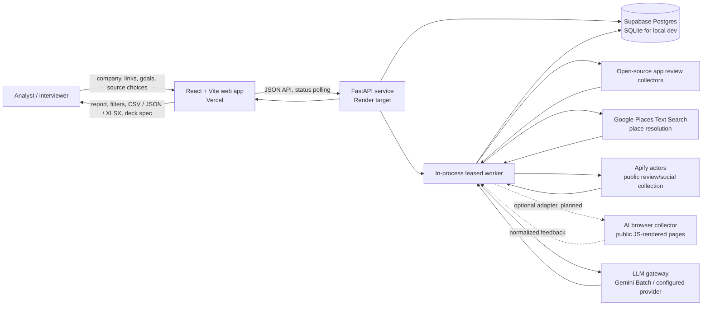
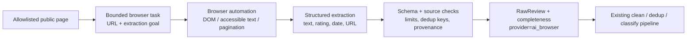
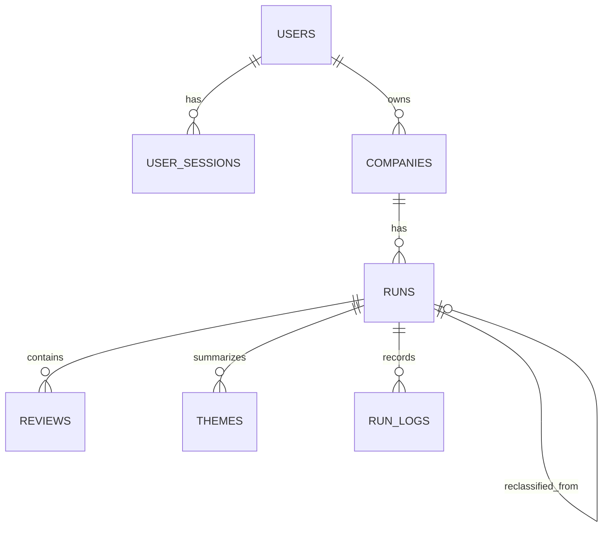

# Voice of Customer Intelligence Platform

## High-level design

**Interview version · 13 October 2026**

An evidence-first platform that turns public customer feedback into an auditable, company-specific issue taxonomy, prioritized insights, and concrete diagnostic actions. The design favors broad, explainable coverage over retrieving a few semantically similar examples: it discovers themes from the selected corpus, classifies each selected review, and keeps the review evidence connected to every reported theme.

> **Implementation boundary:** The current repository implements the ingestion adapters, normalization and deduplication, batch taxonomy discovery and classification, persistence, report APIs, and dashboard. AI browser automation is included below as an additional adapter design; it is not currently implemented in this codebase.

## 1. System context



### Main design choices

| Concern | Design | Why it fits this product |
|---|---|---|
| Analysis shape | Corpus-wide theme discovery followed by a full classification pass | The job is to find and count the issue distribution in a selected dataset, not answer a question from top-k retrieved snippets. This also keeps coverage and run outputs auditable. |
| Taxonomy | Run-specific L1 issue themes with L2 sub-issues | Preserves useful detail without forcing feedback into a fixed complaint / request / praise bucket. |
| Processing | Long-running worker behind a request/response API | Scraping and batch classification take minutes; the UI can poll progress while the worker continues. |
| Persistence | Relational run/review records plus JSONB for snapshots, settings, logs, and taxonomy detail | Supports filtered review queries and durable run history while allowing report payloads and evolving metadata to change. |
| Model boundary | A gateway owns prompts, provider calls, batching, retries, usage, and progress events | Keeps provider-specific behavior out of pipeline orchestration and makes cost and quality observable. |
| Report synthesis | Generate from ranked evidence and representative quotes only | Produces actions tied to observed feedback and avoids presenting speculation as a fact. |

### How the platform evolved

| Earlier shape | Current product direction |
|---|---|
| Internal multi-channel feedback pipeline that classified issues and routed urgent signals to Slack | Analyst-facing workflow with run history, transparent progress/completeness, filterable evidence, exports, and shareable reports |
| Fixed sentiment/feedback buckets | Dynamic company-specific L1 issue taxonomy with L2 sub-issues |
| Source-specific integrations and outputs | Common source adapter contract, source-level status/cost tracking, and consistent report schema |
| One analysis pass | Explicit stages for collection, cleaning, taxonomy discovery, complete classification, quality repair, evidence ranking, and mission-aware synthesis |
| Operational alerts as the primary action | Evidence-linked L2 diagnostic actions with a customer outcome to measure |
| Re-run could reuse old labels | Fresh complete classification for each run; a separate reclassification path can reuse stored source text without scraping again |

The internal version is where the original customer-impact story comes from; the current repo represents the broader self-serve/reporting product. Keep those deployment scopes distinct when describing the project.

## 2. Logical architecture

```mermaid
flowchart TB
    subgraph Experience[Experience layer]
      Onboard[Company onboarding\nsource plan + analysis goals]
      Dashboard[Dashboard / run history]
      Results[Results workspace\nL1/L2, evidence, filters]
      Export[CSV / JSON / XLSX\nDeck specification]
    end

    subgraph Service[API and orchestration]
      API[FastAPI REST API]
      Identity[Guest and email-session identity\nworkspace/run access checks]
      Queue[Run records + queued status]
      Worker[Single in-process worker\nPostgres lease + stale-run recovery]
    end

    subgraph Pipeline[Analysis pipeline]
      Plan[Resolve links + selected source plan]
      Collect[Source adapters\nOSS, Places API, Apify\nAI browser: planned adapter]
      Normalize[Normalize + validate\nsource/date/rating/text]
      Filter[Exact + MinHash/LSH dedup\nrelevance / rating selection]
      Discover[Discover and consolidate\nL1/L2 taxonomy]
      Classify[Classify every selected review\nbatched structured output]
      Gate[Quality gate\nrepair high Other share]
      Rank[Rank themes + choose evidence]
      Synthesize[Mission-aware synthesis\nexecutive points + L2 actions]
      Snapshot[Freeze report snapshot]
    end

    subgraph Data[Data and external systems]
      DB[(Supabase Postgres)]
      LLM[Gemini Batch API\n(or configured gateway provider)]
      Sources[Public review and social sources]
    end

    Onboard --> API
    Dashboard --> API
    Results --> API
    Export --> API
    API --> Identity
    API --> Queue
    Queue --> Worker
    Worker --> Plan --> Collect
    Collect <--> Sources
    Collect --> Normalize --> Filter --> Discover
    Discover <--> LLM
    Discover --> Classify
    Classify <--> LLM
    Classify --> Gate --> Rank --> Synthesize
    Synthesize <--> LLM
    Worker <--> DB
    Worker --> Snapshot --> DB
    API <--> DB
    API --> Experience
```

## 3. End-to-end data flow

1. **Configure a run.** An analyst identifies the company, supplies store / website / social links, chooses supported public sources, and can set analysis goals and a focus. The service resolves store IDs and a brand keyword where possible.
2. **Create a durable run.** The API checks workspace access, applies source planning and current settings, creates a run in `queued`, and returns its ID. The UI shows run status and logs without holding the original request open.
3. **Collect per source.** The worker records source attempts, provider, counts, and cost. Google Play and App Store use open-source collectors first. Google Maps uses Places Text Search to resolve the intended business before collecting its reviews. Other enabled public sources use configured Apify actors. Source failures are recorded independently so useful results can still be returned as `partial`.
4. **Normalize and select.** Adapters map source payloads to `RawReview(source, text, date, rating, external_id)`. The cleaner strips unsafe controls, normalizes whitespace, detects language including Hindi/Hinglish hints, and deduplicates exact hashes plus near-duplicates with MinHash/LSH. Rated sources use 1–3 star reviews for final analysis. Social sources require an on-brand, experiential mention; non-experiential questions/listings are excluded.
5. **Discover the taxonomy.** The LLM sees all selected reviews in bounded chunks (currently up to 1,000 reviews per discovery chunk), proposes issue themes, then consolidates proposals. The taxonomy is capped at 20 L1 themes and 10 L2 sub-issues per L1. It is specific to the run rather than a fixed global taxonomy.
6. **Classify the complete selected set.** Compact review rows are sent in configurable batches (default 100). Each review receives an L1 and, where supported, L2 label. Classification progress, provider/model, token usage, retries, cost, and quarantined batches are written to run logs. A rerun classifies all selected reviews again. A separate reclassification flow can reuse stored review text without recollecting it.
7. **Apply quality checks.** If `other` exceeds 15% before repair, the worker makes one taxonomy repair pass over those rows and reclassifies them. L2 labels are only retained for an L1 with at least five supporting rows. Failed or malformed outputs are visible in quality metadata and can make the run partial/low-confidence.
8. **Rank and synthesize.** Deterministic aggregation calculates theme counts, weighted frequency, source mix, recency, representative quotes, and L2 evidence. The LLM receives this bounded evidence plus the analyst's goals/focus and returns five executive pulse points, five recommended actions, and concrete L2 diagnostic steps. It is instructed not to invent metrics or causes.
9. **Persist and serve.** The worker stores reviews, taxonomy, run completeness, summary, costs, and a frozen report snapshot. The API serves paginated and filterable evidence, status/logs, downloads, a deck-spec, and optional read-only share links. Snapshot serving avoids loading every review just to refresh a report.

## 4. Source ingestion and AI browser use

### Current collectors in the repository

| Source | Current approach | Controls / caveats |
|---|---|---|
| Google Play | OSS scraper first; Apify actor is configured as a paid fallback, but the current global setting disables paid store fallbacks | Fetches English and Hindi in the current collector path; configured review cap applies. |
| Apple App Store | OSS scraper first; paid fallback is likewise disabled | Current cap is 500 reviews. |
| Google Maps | Places Text Search resolves a likely business/place; Apify actor collects reviews for accepted place IDs | Opt-in; cap 100; if no accepted business match exists, do not scrape generic name matches. Requires Maps API credentials. |
| Reddit | Apify Reddit actor | Opt-in; cap 100; keyword search, public posts, and residential proxy configuration are actor inputs. |
| Instagram / X | Configured Apify actors and source-specific queries | Optional public data; bounded query/result limits. Source fields and current enablement are deployment/config dependent. |
| MouthShut | Actor seam exists | Disabled by default in current product decisions. |

All collectors should emit the same normalized `RawReview` contract and a source-completeness record. This decouples downstream cleaning/classification from source-specific schemas and makes failures, caps, and costs comparable.

### AI browser collector: proposed adapter

AI browser use can be useful where the feedback is public but rendered through client-side JavaScript or a site has no stable public API / usable scraper. It belongs **beside** the existing source adapters, before normalization; it should not become a second analysis pipeline.



**Proposed controls:** restrict navigation to approved domains and public pages; use read-only actions; cap pages, records, elapsed time, and spend; retain source URL and collection timestamp for provenance; validate structured output against the same review schema; log browser/model version, extraction failures, and counts; and fail the source cleanly when extraction is uncertain. Do not bypass login, paywalls, CAPTCHA, access controls, or robots / site restrictions. Prefer a documented API or deterministic collector when it is available, cheaper, and stable. For the interview, describe AI browser use as a targeted fallback for difficult public pages—not as the default for every source.

## 5. Data model and API responsibilities



| Entity | Purpose |
|---|---|
| `users`, `user_sessions` | Email session identity; only a hash of the opaque session token is stored. |
| `companies` | Tenant-owned or guest workspace, source links/selections, business type, and analysis mission. |
| `runs` | Lifecycle state, reclassification source, source counts/completeness, model, budget, quality metrics, summary, and frozen report snapshot. |
| `reviews` | Per-run normalized evidence, source, date, rating, detected language, L1/L2 labels, and representative flag. Unique `(run_id, review_hash)` prevents duplicate persisted evidence within a run. |
| `themes` | Ranked theme aggregates, representative quotes, and nested L2 sub-issues/actions. |
| `run_logs` | Append-style stage/source/model events with costs, tokens, attempts, and JSON details for traceability. |
| `settings` | Provider/model, caps, batch size, recency window, dedup threshold, budget, and source weights. |
| `api_usage_daily`, `egress_warnings` | API response-size/request telemetry and projected Supabase egress thresholds. |

The frontend uses REST endpoints for onboarding/discovery, run submission and status, run history, results, review pages, logs, downloads, settings, and share links. Large review tables are paginated and filtered server-side. The API performs ownership / guest access checks before returning a run; public share tokens expose read-only report routes separately.

## 6. Reliability, quality, privacy, and cost

### Reliability and observability

- Run states are `queued → scraping → classifying → done | partial | failed`.
- A database-backed worker lease prevents multiple service instances from processing the same queue simultaneously; it is renewed periodically.
- A stale-run recovery check requeues active runs that stop producing logs, clearing incomplete outputs before a full retry.
- Per-source attempt status and completeness are persisted so partial collection is visible instead of silently replaced with sample data.
- LLM batch progress, token/cost estimates, quarantine/retry details, and API response-byte telemetry are available for diagnosis.
- Report snapshots make read paths cheaper; raw review access is paginated.

### Quality and AI safeguards

- Every classified tag links to a persisted review hash; representative quotes come from the classified evidence.
- Structured compact inputs/outputs reduce prompt size and make classification auditable.
- The quality gate repairs an overly broad `other` category once, then retains the measured result rather than hiding remaining uncertainty.
- Synthesis receives only ranked, bounded evidence and is told not to infer causes, quote customers, or invent business metrics.
- Model quality should be tracked separately from business outcomes: taxonomy coverage/`other` share, label agreement on reviewed samples, quarantine rate, and action usefulness; alongside user behavior and business outcomes such as adoption of reports and customer metric movement.

### Privacy and security considerations

- The platform collects public feedback and stores review text to support evidence review and reclassification. Keep source provenance and access boundaries attached to that data.
- Sessions are opaque and stored hashed; guest IDs are shape-validated. Run routes use workspace ownership checks; explicit share tokens serve a separate read-only path.
- API keys remain in service configuration, never in the browser. Error/log paths redact common token and API-key formats.
- Use bounded retention, deletion, and export policies appropriate to the data source and applicable terms. Avoid collecting private messages or content behind access controls.

### Cost controls

- Source-specific result caps and a per-run budget constrain collection spend.
- Free OSS collectors run before paid store fallback; paid store fallback is currently disabled in code. Paid Apify collection is metered per source/result.
- Batch classification is the default Gemini path and has lower unit pricing than synchronous calls. Batch status, token usage, and cost are logged.
- Reclassification reuses stored reviews and avoids repeat collection cost, while still running a fresh complete classification.
- If the budget or a source fails, the report records a partial outcome and completeness details.

## 7. Deployment topology and operating model

| Layer | Intended deployment | Notes |
|---|---|---|
| Web | React + Vite on Vercel | Static application; API base URL is configured at build/deploy time. |
| API + worker | FastAPI long-running service on Render | Worker is in-process with the API and uses a database lease. This is deliberately not a short-lived serverless function because runs can take minutes. |
| Database | Supabase Postgres | Local development falls back to SQLite when `DATABASE_URL` is unset. |
| External services | Gemini, Apify, Google Places | Keys are server-side secrets. Optional providers/sources can be disabled through config. |

**Scale path:** the current single-worker lease is a simple first production shape. If run concurrency or throughput grows, split API and workers, move the queue to a durable queue service, and use independent worker leases/concurrency limits. Keep idempotent run stages and per-source checkpoints so retries do not duplicate or corrupt completed work. At higher volume, stage raw source payloads in object storage with retention controls, bulk-write reviews, and partition/index review tables around actual query patterns. Add per-tenant quotas and provider concurrency controls before enabling more parallel collection.

## 8. Trade-offs and next design steps

| Decision | Benefit | Cost / follow-up |
|---|---|---|
| Full-corpus classification instead of RAG/top-k | Exhaustive denominator and auditable issue distribution | Higher latency and token spend; batch calls, caps, and budgets keep it bounded. |
| Dynamic taxonomy per run | Surfaces company-specific and previously unseen problems | Cross-run trend comparison needs taxonomy alignment/versioning; do not assume identical labels mean identical definitions. |
| One in-process worker with a DB lease | Small operational footprint and easy deployment | Limited throughput and shared failure domain; extract a durable queue when volume justifies it. |
| MinHash/LSH near-dedup | Removes syndicated / near-identical feedback before counting | Similar complaints can be merged; tune threshold against a labeled duplicate set and retain dedup metrics. |
| Public web collection across vendors | Broader channel coverage | Terms, schema drift, availability, and spend vary by source; maintain per-source contracts and fallback behavior. |
| AI browser collector (planned) | Can reach selected JS-rendered public pages without a bespoke scraper | Less deterministic, slower, and harder to maintain; allowlist it, constrain actions, validate output, and use only when stable structured methods fail. |

Recommended next steps are: (1) put AI browser collection behind a feature-flagged adapter and prove extraction precision on one approved public source, (2) add a labeled review set for multilingual taxonomy and near-duplicate quality, (3) version and align taxonomies for trend reporting across runs, and (4) separate workers from the API when queue throughput or deployment isolation requires it.

## 9. Interview talk track

> “I built a voice-of-customer platform that collects public feedback across app stores, Maps, Reddit, and social sources, then converts it into a company-specific, evidence-backed issue map. A key decision was not to use RAG as the core analysis step: the product needed a complete distribution of issues, so we discover a taxonomy from the full selected corpus and classify every eligible review in batches. We normalize and deduplicate first, log source completeness and model cost, and preserve the review-to-theme links. Then we produce ranked L1/L2 themes, representative evidence, and diagnostic actions grounded in those themes. The system runs as a React frontend, FastAPI API and long-running worker, and Postgres database. AI browser automation is a planned additional collector for difficult public, JavaScript-rendered pages; it would feed the same normalized contract and be bounded by domain, page, time, and spend controls.”

**Impact to cite carefully:** The original internal VoC system was associated with discovering 15 previously unknown issue categories and a 5-point NPS improvement. Present those as outcomes from that deployment and be ready to explain the measurement window, attribution, and your role. The current product repo also records hosted sample analyses and per-run operational evidence; those run-specific counts/costs are examples, not universal platform guarantees.

## 10. Source-of-truth notes

This document is based on the current implementation in `backend/app/pipeline/`, `backend/app/main.py`, `backend/app/models.py`, `data/supabase/schema.sql`, `backend/scrapers/app_reviews.js`, and the product decisions in `DECISIONS.md`. The browser collector is an interview-oriented architecture extension and should not be described as shipped code.
